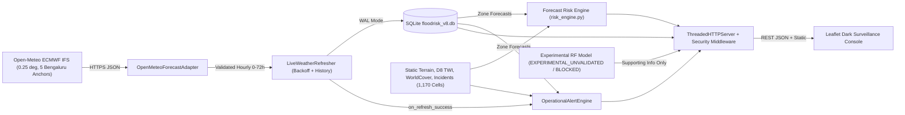

# V8 Architecture & Data-Flow Documentation

## System Architecture

## Forecast-to-Risk Data Flow

1. **Ingestion (`src/floodrisk/live/open_meteo.py`, `scheduler.py`):**
   - Queries 5 Bengaluru sector anchors (`bengaluru_centroid`, `blr_north_west`, `blr_north_east`, `blr_south_west`, `blr_south_east`) in a single batched HTTP request.
   - Records hourly `precipitation`, `rain`, `temperature_2m`, and `relative_humidity_2m` up to 72 hours, plus `forecast_refresh_history` in SQLite (`PRAGMA user_version = 2`).
2. **Cumulative Windows (`src/floodrisk/live/forecast_metrics.py`):**
   - Computes cumulative and maximum hourly rainfall for `1h, 3h, 6h, 12h, 24h, 48h, 72h` windows while tracking `available_hours` and `missing_hours`.
3. **Spatial Assignment (`src/floodrisk/alerts/spatial.py`):**
   - Assigns each 1 km cell to its nearest fresh (`LIVE`/`RECENT`) sector anchor within `25.0 km` (`NEAREST_SECTOR_ANCHOR_NO_INTERPOLATION`). Cells outside coverage or with stale anchors are marked `INSUFFICIENT_SPATIAL_COVERAGE` / `INSUFFICIENT_DATA`.
4. **Risk Prioritisation (`src/floodrisk/alerts/risk_engine.py`):**
   - Combines static terrain susceptibility (35%), D8 TWI/drainage (20%), impervious land cover (15%), and horizon-scaled forecast rainfall (30%) into a non-probabilistic index `[0, 1]`.
5. **Safety Gates:**
   - `public_dispatch_enabled = False`
   - `warning_gate = "BLOCKED_EXPERIMENTAL_MODEL"`
   - Frozen V7.2 baseline datasets and manifests remain unmodified.
