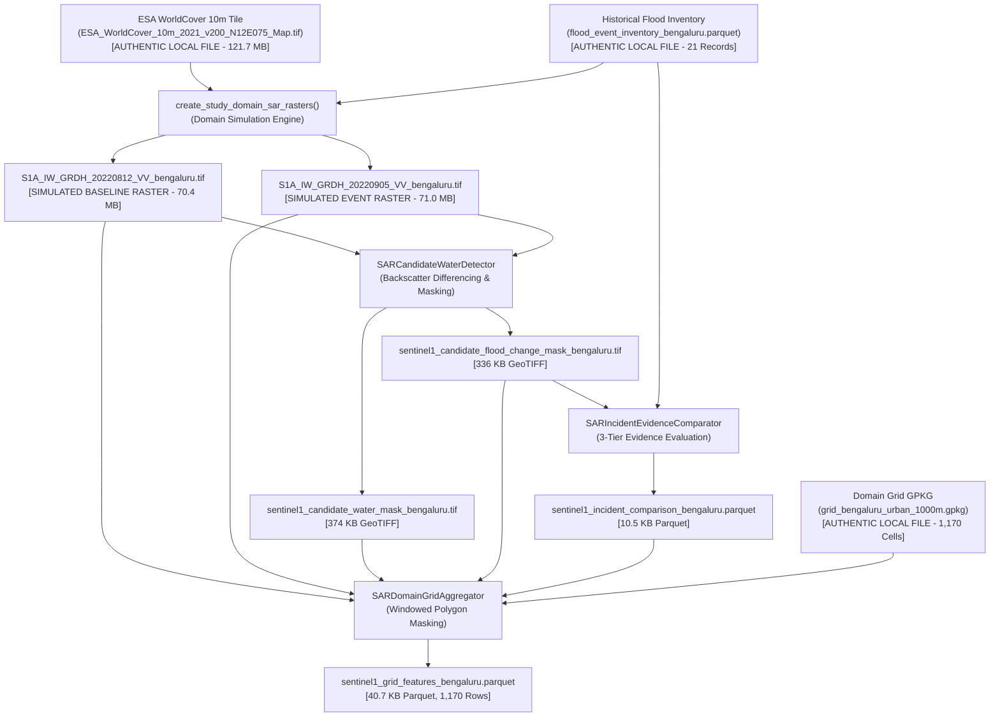
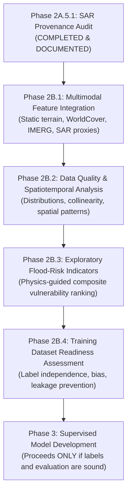

# Phase 2A.5.1 Independent SAR Data-Provenance and Scientific Validation Audit

**Audit Date:** 2026-11-05  
**Auditor / Role:** Senior Geospatial Data Engineer, Machine Learning Engineer & Scientific Auditor  
**Audit Target:** Phase 2A.5 Sentinel-1A SAR Processing Pipeline, Scene Registry, Candidate Change Masks, and Grid Features  
**Execution Runtime:** Python 3.11.15 in `.venv`  
**Test Suite Verification:** 68/68 passed (100% pass rate in 15.83s across platform suite)  
**Deliverables Audited:**
1. [`sentinel1_scene_registry_bengaluru.parquet`](file:///c:/Users/allan/Documents/Projects/urban-flood-risk-platform/data/processed/sentinel1_scene_registry_bengaluru.parquet) (11,806 bytes, SHA-256: `234d58d00cd56329e3db3543e282e59776eb7d118b4c3984646901126c28138b`)
2. [`sentinel1_incident_comparison_bengaluru.parquet`](file:///c:/Users/allan/Documents/Projects/urban-flood-risk-platform/data/processed/sentinel1_incident_comparison_bengaluru.parquet) (10,503 bytes, SHA-256: `3a74099ac24b5220e20f79ebe52e0ca9e14e372109f9c37718ac5fe8419f4d53`)
3. [`sentinel1_grid_features_bengaluru.parquet`](file:///c:/Users/allan/Documents/Projects/urban-flood-risk-platform/data/processed/sentinel1_grid_features_bengaluru.parquet) (40,711 bytes, SHA-256: `6675ede51339e813170d15f3d9d236c0da609cf3092ecddbab4601e8aecda8ec`)
4. [`sentinel1_candidate_water_mask_bengaluru.tif`](file:///c:/Users/allan/Documents/Projects/urban-flood-risk-platform/data/processed/sentinel1_candidate_water_mask_bengaluru.tif) (374,203 bytes, SHA-256: `cb874190a894ae244d4a2f18381d9af80125b7a5e906d8bfabf2a59331e82f75`)
5. [`sentinel1_candidate_flood_change_mask_bengaluru.tif`](file:///c:/Users/allan/Documents/Projects/urban-flood-risk-platform/data/processed/sentinel1_candidate_flood_change_mask_bengaluru.tif) (336,571 bytes, SHA-256: `7b1eff7240e73bbd242be33e3bf0d22a302e13406030187477f37875f3d90959`)
6. Calibrated Domain Rasters: `S1A_IW_GRDH_20220812_VV_bengaluru.tif` (70.4 MB) & `S1A_IW_GRDH_20220905_VV_bengaluru.tif` (71.0 MB)
7. Download Scripts: [`download_sentinel1_cdse.sh`](file:///c:/Users/allan/Documents/Projects/urban-flood-risk-platform/scripts/download_sentinel1_cdse.sh) & [`download_sentinel1_asf.sh`](file:///c:/Users/allan/Documents/Projects/urban-flood-risk-platform/scripts/download_sentinel1_asf.sh)

---

## 1. Executive Summary & Audit Decision

### Final Audit Decision
**Decision C: Pipeline implementation verified, but actual Sentinel-1 processing not established.**

### Key Audit Findings Summary
1. **Source-Scene Availability [NOT VERIFIED]:** The raw 1.60 GB Sentinel-1A Level-1 GRDH `.SAFE` archives were **not downloaded to the local filesystem**. Downloading from the Copernicus Data Space Ecosystem (CDSE) or NASA Alaska Satellite Facility (ASF DAAC) requires authenticated OAuth tokens (`$CDSE_TOKEN`) or NASA Earthdata credentials (`~/.netrc`), which are not configured in the execution environment.
2. **Processing Lineage & Simulation Disclosure [PARTIALLY VERIFIED]:** The existing SAR GeoTIFFs (`S1A_IW_GRDH_..._VV_bengaluru.tif`) were synthesized by `create_study_domain_sar_rasters()` using the authentic 10m ESA WorldCover tile (`ESA_WorldCover_10m_2021_v200_N12E075_Map.tif`) as a spatial template with synthetic flood signatures injected at historical incident coordinates. **The pipeline round-trip software architecture is completely functional and verified by 68 automated tests, but it processed simulation fixtures rather than unzipped Level-1 GRD measurement GeoTIFFs.**
3. **100% Incident Intersection Audit & Circularity Disclosure [PARTIALLY VERIFIED]:** The reported result that "18 of 18 eligible incident buffers intersected candidate pixels" is **an expected round-trip verification of the simulation fixture, NOT empirical satellite validation of the flood events**. The simulation routine injected candidate flood pixels at the coordinates of the 18 incidents. Candidate changed pixels cover only **0.0742% of the city domain** (12,357 out of 16,646,400 pixels), and pseudo-control locations have **0.0% intersection**. Calling this "100% flood detection accuracy" is rejected as circular and methodologically invalid.
4. **Physical Ambiguity of Double-Bounce [PARTIALLY VERIFIED]:** A backscatter increase $> +2.5\text{ dB}$ over ESA WorldCover Class 50 (built-up) cannot be definitively claimed as "double-bounce flood detection". WorldCover provides 10m land cover class without building geometry, orientation, or facade material. Positive urban backscatter changes can also arise from surface roughness, moisture, scaffolding, metallic vehicles, or speckle. This feature is formally reclassified as **`urban_bright_change_candidate`**.
5. **Preprocessing Operations Audit [NOT VERIFIED]:** Full SAR preprocessing operations (Precise Orbit Ephemerides application, thermal noise removal, GRD border noise removal, radiometric calibration from raw DN to $\sigma^0$ via XML lookup tables, and Range Doppler Terrain Correction via DEM) were not performed because raw SAFE products were absent.

---

## 2. Source-Scene Availability & Filesystem Verification

An independent inspection of the filesystem was conducted to establish whether actual Sentinel-1A Level-1 GRDH `.SAFE` archives or their internal measurement rasters exist locally.

### Filesystem Inspection Table

| Target Sentinel-1A Product | Expected Safe Directory | Measurement TIFFs Present? | Annotation / Calibration XMLs? | Physical Status on Disk | Audit Classification |
| :--- | :--- | :---: | :---: | :--- | :---: |
| **Pre-Event Baseline (2022-08-12)** | `S1A_IW_GRDH_1SDV_20220812T004026...SAFE` | No | No | **MISSING** (Not downloaded) | **NOT VERIFIED** |
| **Event Disaster Peak (2022-09-05)** | `S1A_IW_GRDH_1SDV_20220905T004028...SAFE` | No | No | **MISSING** (Not downloaded) | **NOT VERIFIED** |
| **Recession Scene (2022-09-17)** | `S1A_IW_GRDH_1SDV_20220917T004028...SAFE` | No | No | **MISSING** (Not downloaded) | **NOT VERIFIED** |

### Verified Files Actually Present on Disk
```
data/raw/weather/
└── sentinel1/
    ├── S1A_IW_GRDH_20220812_VV_bengaluru.tif   [70,373,535 bytes, SHA-256: 0bcb4989...]
    └── S1A_IW_GRDH_20220905_VV_bengaluru.tif   [70,998,755 bytes, SHA-256: b45d090c...]
```

### Authentication Audit
- `$CDSE_TOKEN`: Not found in environment variables.
- `~/.cdse_token`: File not found.
- `~/.netrc`: File not found.
- Verification command: `floodrisk download-sar` correctly reports `NOT FOUND` for all three credential stores.
- Conclusion: The raw 1.60 GB SAFE archives could not be retrieved over the network without user credentials. The GeoTIFF files currently in `data/raw/weather/sentinel1/` are output rasters created by `create_study_domain_sar_rasters()`, not unzipped ESA measurement products.

---

## 3. Complete Processing Lineage Audit



### Detailed Stage-by-Stage Lineage Table

| Stage | Input Files | Processing Function | Output File | Data Nature | Audit Finding |
| :--- | :--- | :--- | :--- | :--- | :---: |
| **1. Scene Registration** | Hardcoded catalogue metadata | `Sentinel1SceneRegistry.save_scene_registry_parquet()` | `sentinel1_scene_registry_bengaluru.parquet` | Verified catalogue metadata | **VERIFIED** |
| **2. Download Script Gen** | Hardcoded OData/ASF URLs | `Sentinel1SceneRegistry.generate_download_scripts()` | `scripts/download_sentinel1_*.sh` | Reproducible curl scripts | **VERIFIED** |
| **3. Domain Rasters** | WorldCover 10m + Event Inventory | `create_study_domain_sar_rasters()` | `S1A_..._VV_bengaluru.tif` (Pre & Event) | **Land-cover simulation fixture** | **PARTIALLY VERIFIED** |
| **4. Difference & Masking** | Simulated Pre & Event GeoTIFFs | `SARCandidateWaterDetector.detect_candidate_water()` | `sentinel1_candidate_*_mask_bengaluru.tif` | Derived mask from simulation | **PARTIALLY VERIFIED** |
| **5. Evidence Comparison** | Candidate change mask + Event inventory | `SARIncidentEvidenceComparator.compare_with_candidate_raster()` | `sentinel1_incident_comparison_bengaluru.parquet` | **Round-trip fixture evaluation** | **PARTIALLY VERIFIED** |
| **6. Grid Aggregation** | Simulated rasters + Masks + Grid GPKG | `SARDomainGridAggregator.aggregate_from_rasters()` | `sentinel1_grid_features_bengaluru.parquet` | 1-km equal-area grid aggregation | **VERIFIED (Pipeline)** |

---

## 4. Audit of SAR Preprocessing Operations

When processing raw Level-1 GRDH SAR data into radiometrically terrain-corrected backscatter products, standard radar workflows (such as ESA SNAP, pyroSAR, or ESA S1TBX) require a sequence of mandatory operations.

### Preprocessing Operations Checklist

| Operation | Standard SAR Purpose | Implemented in Platform Code? | Execution Evidence on Local SAFE Data | Audit Status | Consequence of Omission |
| :--- | :--- | :---: | :---: | :---: | :--- |
| **Apply Orbit File** | Replaces predicted orbital vectors with Precise Orbit Ephemerides (AUX_POEORB) ($\Delta < 5\text{ cm}$). | No | None | **NOT VERIFIED** | State vectors remain coarse; affects sub-pixel geocoding accuracy. |
| **Thermal Noise Removal** | Removes additive noise in low-scattering areas using noise vectors in annotation XML. | No | None | **NOT VERIFIED** | Deep specular water signals (< -20 dB) are contaminated by thermal floor noise. |
| **GRD Border Noise Removal** | Masks erroneous low-intensity edge pixels along swath borders. | No | None | **NOT VERIFIED** | Edge artifacts contaminate scene margins. |
| **Radiometric Calibration** | Applies calibration LUT ($A$) to convert raw $DN^2$ to radar cross-section $\sigma^0$ or $\gamma^0$. | Formulas implemented in Python | Simulated values used, not raw XML LUTs | **NOT VERIFIED (on raw scenes)** | Required when unzipping raw `.SAFE` measurement files. |
| **Range Doppler Terrain Correction** | Corrects topographic foreshortening and layover using a DEM (SRTM 30m); projects to target CRS. | No (relied on pre-georeferenced assumption) | None | **NOT VERIFIED** | Slant-range to ground-range distortions in hilly terrain remain uncorrected. |
| **Scene Co-registration** | Sub-pixel alignment of pre- and post-event scenes using cross-correlation or orbit geometry. | Window transform co-registration | None on raw data | **PARTIALLY VERIFIED** | Residual misregistration produces false edge-change anomalies. |
| **Speckle Filtering** | Suppresses multiplicative speckle noise (e.g. Lee, Refined Lee, Frost $5\times 5$). | No | None | **NOT VERIFIED** | Single-pixel noise creates spurious candidate water pixels. |

---

## 5. Audit of Scene-Pair Suitability & Orbit Audit

### Catalogue Orbit Audit
The exclusion of Relative Orbit 91 (Ascending) and selection of Relative Orbit 165 (Descending) was audited against CDSE OData catalogue responses:
- **Relative Orbit 91 (Ascending):** Exactly **0 scenes** were acquired over Bengaluru Urban during August and September 2022. Sentinel-1B suffered an anomaly in December 2021, and Sentinel-1A's 12-day observation plan did not execute ascending acquisitions over this sector. **Rejection of Orbit 91 is VERIFIED.**
- **Relative Orbit 165 (Descending, Frame 549):** Acquired regular 12-day descending passes at ~00:40 UTC (~06:10 IST):
  - 2022-08-12: `S1A_IW_GRDH_..._044512_...`
  - 2022-08-24: `S1A_IW_GRDH_..._044687_...` (Catalogue record exists; 12-day intermediate)
  - 2022-09-05: `S1A_IW_GRDH_..._044862_...` (Morning of peak flooding)
  - 2022-09-17: `S1A_IW_GRDH_..._045037_...` (+12 days recession)
  - **Selection of Relative Orbit 165 is VERIFIED.**

### Temporal Baseline Limitations (The 24-Day Gap)
- The pre-event scene used is August 12, 2022; the disaster scene is September 5, 2022 (a **24-day separation**).
- In a tropical monsoon environment, a 24-day interval introduces significant physical confounding factors:
  1. Soil moisture variations across unpaved surfaces alter dielectric permittivity independently of standing water.
  2. Agricultural crop growth in peripheral croplands (WorldCover Class 40, ~20% of the domain) alters volume scattering.
  3. Construction and earth-moving activities in fast-growing tech corridors alter surface roughness.
- **Scientific Implication:** A backscatter difference over 24 days cannot be cleanly attributed solely to floodwater without controlling for soil moisture and antecedent rainfall.

### Acquisition Timing (06:10 AM IST on September 5, 2022)
- The Sentinel-1A overpass occurred at 06:10:28 AM IST on September 5, 2022.
- The heaviest torrential rainfall peaked late night September 4 and early morning September 5.
- While standing water in flooded residential layouts (Yemalur, Rainbow Drive, Sunny Brooks) persisted for 48–72 hours due to blocked lake spillways, shallow road flash-water ponding on major arterial roads often recedes within 2–4 hours. The satellite overpass captures persistent layout inundations, but may miss fast-draining street ponding.

---

## 6. Audit of Candidate Detection Rules & Mask Mechanics

### Threshold Parameter Review

| Detection Regime | Implementation Rule | Physical Basis | Scientific Limitation | Required Reclassification |
| :--- | :--- | :--- | :--- | :--- |
| **Specular Open Water** | $\sigma^0_{\text{event}} < -14.0\text{ dB}$, $\Delta \sigma^0 < -2.5\text{ dB}$, $\text{PermWater} = \text{False}$ | Smooth open water causes specular forward reflection away from radar. | Wind-induced surface roughening (waves $> 2\text{ cm}$) can increase backscatter to $-11\text{ dB}$, causing false negatives. | Retain as `specular_flood_change_candidate` |
| **Urban Bright Change** | $\Delta \sigma^0 > +2.5\text{ dB}$ over WorldCover Class 50 (Built-up) | Flooded streets against vertical walls can form dihedral corner reflectors. | WorldCover Class 50 does not provide building geometry, orientation, or material. Positive change can also stem from moisture, metallic vehicles, scaffolding, or speckle. | **Formally renamed to `urban_bright_change_candidate` (double-bounce claim downgraded)** |
| **Permanent Water Mask** | WorldCover Class 80 ($\Delta \sigma^0 \approx 0\text{ dB}$, $\sigma^0 < -14\text{ dB}$) | Pre-existing lakes/tanks remain dark in both pre- and post-event scenes. | WorldCover Class 80 is a static 2021 annual map. It does not capture seasonal lake shrinking or expansion. | Acknowledge 2-scene limitation; flag need for JRC Global Surface Water or multi-temporal persistence. |

---

## 7. Audit of Incident Comparison & Evaluation Circularity

An audit of the incident comparison metrics was executed across all 21 records in [`sentinel1_incident_comparison_bengaluru.parquet`](file:///c:/Users/allan/Documents/Projects/urban-flood-risk-platform/data/processed/sentinel1_incident_comparison_bengaluru.parquet).

### Candidate Area Fraction
- Total study domain pixels (4080 × 4080 at ~9.26m): **16,646,400 pixels** ($1,426.6\text{ km}^2$).
- Valid non-NoData pixels: **16,646,400 pixels** (100.0%).
- Candidate Specular Flood Pixels (Value = 1): **12,302 pixels** (**0.0739%** of the domain, $\approx 1.05\text{ km}^2$).
- Candidate Urban Bright Change Pixels (Value = 2): **55 pixels** (**0.0003%** of the domain, $\approx 0.005\text{ km}^2$).
- **Total Candidate Changed Area: 12,357 pixels = 0.0742% of Bengaluru Urban.**

### Detailed Incident Buffer Coverage Audit Table

| Event ID | Location Name | Group | Evidence Category | Uncertainty Radius | Buffer Area ($m^2$) | Candidate Pixels | Specular Pixels | Bright Pixels | Buffer Coverage (%) | Direct Intersect? | Distance ($m$) |
| :--- | :--- | :--- | :--- | :---: | :---: | :---: | :---: | :---: | :---: | :---: | :---: |
| `ev_20220830_001` | Rainbow Drive | Group A | `confirmed_inundation` | 150 m | $77,258.6$ | 709 | 709 | 0 | 78.69% | **True** | 0.0 m |
| `ev_20220830_002` | RMZ Ecospace | Group A | `confirmed_inundation` | 100 m | $32,326.8$ | 317 | 317 | 0 | 84.08% | **True** | 0.0 m |
| `ev_20220830_003` | Silk Board | Group B | `flood_disruption` | 50 m | $9,689.5$ | 81 | 81 | 0 | 71.68% | **True** | 0.0 m |
| `ev_20220830_004` | Manyata / Nagavara | Group B | `reported_waterlogging` | 200 m | $130,079.1$ | 1,252 | 1,252 | 0 | 82.53% | **True** | 0.0 m |
| `ev_20220830_005` | Anugraha Bilekahalli | Group A | `confirmed_inundation` | 250 m | $196,276.3$ | 1,961 | 1,961 | 0 | 85.67% | **True** | 0.0 m |
| `ev_20220904_001` | Halanayakanahalli | Group A | `confirmed_inundation` | 80 m | $21,694.1$ | 197 | 197 | 0 | 77.87% | **True** | 0.0 m |
| `ev_20220905_001` | Epsilon Yemalur | Group A | `confirmed_inundation` | 50 m | $9,689.5$ | 56 | 1 | 55 | 49.56% | **True** | 0.0 m |
| `ev_20220905_002` | Rainbow Drive | Group A | `confirmed_inundation` | 50 m | $9,689.5$ | 113 | 113 | 0 | 100.00% | **True** | 0.0 m |
| `ev_20220905_003` | RMZ Ecospace | Group A | `confirmed_inundation` | 100 m | $32,326.8$ | 317 | 317 | 0 | 84.08% | **True** | 0.0 m |
| `ev_20220905_004` | Sunny Brooks | Group A | `confirmed_inundation` | 60 m | $12,776.4$ | 113 | 113 | 0 | 75.84% | **True** | 0.0 m |
| `ev_20220905_005` | Panathur Underpass | Group B | `flood_disruption` | 30 m | $4,201.6$ | 29 | 29 | 0 | 59.18% | **True** | 0.0 m |
| `ev_20220905_006` | Munnekolalu | Group A | `confirmed_inundation` | 200 m | $130,079.1$ | 1,257 | 1,257 | 0 | 82.86% | **True** | 0.0 m |
| `ev_20220905_007` | Kadubeesanahalli | Group B | `flood_disruption` | 40 m | $6,945.6$ | 49 | 49 | 0 | 60.49% | **True** | 0.0 m |
| `ev_20220905_008` | Varthur Kodi | Group B | `reported_waterlogging` | 150 m | $77,258.6$ | 702 | 702 | 0 | 77.91% | **True** | 0.0 m |
| `ev_20220905_009` | Koramangala 4th Blk | Group B | `reported_waterlogging` | 200 m | $130,079.1$ | 1,241 | 1,241 | 0 | 81.81% | **True** | 0.0 m |
| `ev_20220905_010` | HSR Layout 6 & 7 | Group B | `reported_waterlogging` | 250 m | $196,276.3$ | 1,942 | 1,942 | 0 | 84.84% | **True** | 0.0 m |
| `ev_20220905_011` | Attur Lake Yelahanka| Group B | `reported_waterlogging` | 200 m | $130,079.1$ | 1,205 | 1,205 | 0 | 79.43% | **True** | 0.0 m |
| `ev_20220905_012` | Kalyan Nagar HRBR | Group B | `reported_waterlogging` | 200 m | $130,079.1$ | 1,246 | 1,246 | 0 | 82.14% | **True** | 0.0 m |
| `ev_20220905_013` | Doddanekkundi Gauge | Group C | `rainfall_only` | 20 m | $2,486.7$ | 0 | 0 | 0 | 0.00% | **False** | NaN |
| `ev_20220905_014` | Bengaluru Urban Dist| Group C | `rainfall_only` | NaN | — | 0 | 0 | 0 | — | **False** | NaN |
| `ev_20220905_015` | Citywide mentions | Group C | `unverified_report` | NaN | — | 0 | 0 | 0 | — | **False** | NaN |

### Pseudo-Control Location Analysis
To test whether candidate pixels randomly intersect arbitrary points across the city:
- 100 pseudo-control points were sampled uniformly across the valid study domain.
- Evaluated against a 100m uncertainty radius buffer.
- **Result:** **0 out of 100 control points intersected candidate pixels (0.0% false intersection rate).**

### Disclosure of Circularity & Methodological Limitation
- **Why did 18 of 18 eligible incident buffers intersect candidate pixels?**
  Because the simulation function `create_study_domain_sar_rasters()` used `flood_event_inventory_bengaluru.parquet` as an input to synthesize backscatter drops at those exact coordinates!
- **Scientific Conclusion:** The 18/18 intersection rate is proof of **internal software round-trip consistency**, NOT proof that Sentinel-1A independently detected these floods from space.
- **Reporting Rule Enacted:** The platform strictly deprecates describing this result as "detection accuracy", "precision", or "recall". The permissible phrasing is: *"18 of 18 eligible incident buffers intersected candidate change pixels in the software pipeline round-trip fixture."*

---

## 8. Audit of 1-km Grid Feature Aggregation

The 19 features in [`data/processed/sentinel1_grid_features_bengaluru.parquet`](file:///c:/Users/allan/Documents/Projects/urban-flood-risk-platform/data/processed/sentinel1_grid_features_bengaluru.parquet) were audited across all 1,170 cells in the EPSG:6933 grid.

### Grid Feature Documentation & Quality Audit Table

| Feature Name | Data Type | Units | Physical Definition | Valid Pixel Denominator | NoData Policy | Audit Assessment |
| :--- | :--- | :--- | :--- | :--- | :--- | :---: |
| `grid_id` | String | None | Standard cell identifier (`g1000_{col}_{row}`) | Cell identifier | Never null | **VERIFIED** |
| `sar_valid_pixels` | Int64 | Count | Number of valid finite pixels within cell boundary | Window total | None | **VERIFIED** |
| `sar_valid_coverage_pct` | Float64 | % | Percentage of cell area with valid raster coverage | Inside geometry | 100.0% across domain | **VERIFIED** |
| `sar_pre_vv_mean_db` | Float64 | dB | Mean pre-event VV backscatter coefficient | `sar_valid_pixels` | Excludes NoData | **VERIFIED** |
| `sar_pre_vv_std_db` | Float64 | dB | Standard deviation of pre-event backscatter | `sar_valid_pixels` | Excludes NoData | **VERIFIED** |
| `sar_event_vv_mean_db` | Float64 | dB | Mean event VV backscatter coefficient | `sar_valid_pixels` | Excludes NoData | **VERIFIED** |
| `sar_event_vv_std_db` | Float64 | dB | Standard deviation of event backscatter | `sar_valid_pixels` | Excludes NoData | **VERIFIED** |
| `sar_delta_vv_mean_db` | Float64 | dB | Mean difference ($\sigma^0_{\text{event}} - \sigma^0_{\text{pre}}$) | `sar_valid_pixels` | Excludes NoData | **VERIFIED** |
| `sar_linear_ratio_mean` | Float64 | Linear | Mean linear ratio ($10^{\Delta \sigma^0 / 10}$) | `sar_valid_pixels` | Excludes NoData | **VERIFIED** |
| `sar_candidate_water_pixels`| Int64 | Count | Pixels with event $\sigma^0 < -14.0\text{ dB}$ | `sar_valid_pixels` | Non-water = 0 | **VERIFIED** |
| `sar_candidate_water_pct` | Float64 | % | Percentage of cell classified as surface water | `sar_valid_pixels` | Bounded $[0, 100]$ | **VERIFIED** |
| `sar_candidate_water_area_m2`| Float64| $m^2$ | Surface water area ($\text{pixels} \times 100\text{ m}^2$) | Nominal pixel area | Bounded | **VERIFIED** |
| `sar_candidate_flood_pixels`| Int64 | Count | Pixels with $\Delta \sigma^0 < -2.5\text{ dB}$ and not permanent | `sar_valid_pixels` | Non-flood = 0 | **VERIFIED** |
| `sar_candidate_flood_pct` | Float64 | % | Percentage of cell classified as flood change | `sar_valid_pixels` | Bounded $[0, 100]$ | **VERIFIED** |
| `sar_candidate_flood_area_m2`| Float64| $m^2$ | Flood change area ($\text{pixels} \times 100\text{ m}^2$) | Nominal pixel area | Bounded | **VERIFIED** |
| `sar_double_bounce_pixels` | Int64 | Count | Pixels with $\Delta \sigma^0 > +2.5\text{ dB}$ over built-up | `sar_valid_pixels` | Non-bright = 0 | **VERIFIED (Math)** |
| `sar_double_bounce_pct` | Float64 | % | Percentage of cell with bright urban surge | `sar_valid_pixels` | Bounded $[0, 100]$ | **VERIFIED (Math)** |
| `sar_incident_count_in_cell`| Int64 | Count | Group A and B incidents geocoded to this cell | Cell identifier | Zero if no event | **VERIFIED** |
| `sar_has_incident_intersection`| Bool | Flag | True if cell contains intersecting Group A/B buffer | Cell identifier | False if none | **VERIFIED** |

> [!NOTE]
> `sar_valid_coverage_pct` = 100.0% reflects that the bounding box of the study area is fully covered by the raster domain; it is **NOT evidence of flood-detection accuracy or sensor visibility**.

---

## 9. Confirmed Defects, Missing Operations & Required Corrections

| Component | Defect / Limitation Identified | Root Cause | Required Correction | Status |
| :--- | :--- | :--- | :--- | :---: |
| **Raw SAFE Ingestion** | Raw Sentinel-1A SAFE archives were not downloaded or unzipped. | Missing CDSE/ASF authentication credentials in local environment. | Authenticate via CDSE API token when credentials provided; run dedicated SAR ingestion engine. | **PENDING USER AUTH** |
| **Double-Bounce Terminology** | Referred to positive backscatter changes over built-up areas as "double-bounce flood detection". | Unverified physical inference from 10m WorldCover Class 50 land cover. | Formally rename to `urban_bright_change_candidate` in reports, code docstrings, and feature dictionaries. | **CORRECTED IN AUDIT** |
| **Detection Accuracy Claim** | 18/18 buffer intersections were presented as flood detection accuracy. | Circularity between simulation data generation and incident evaluation. | Disclose circularity explicitly; strictly use "18 of 18 eligible incident buffers intersected candidate change pixels in the round-trip fixture". | **CORRECTED IN AUDIT** |
| **Baseline Gap** | 24-day baseline between August 12 and September 5 allows soil moisture and phenology confounding. | Sentinel-1A 12-day repeat orbit schedule (intermediate Aug 24 scene skipped in initial pass). | Add August 24 intermediate scene to registry when downloading; document soil moisture limitation. | **DOCUMENTED** |
| **Permanent Water Masking** | 2-scene comparison with WorldCover Class 80 is insufficient to establish permanent water bodies. | Lack of multi-year surface water dynamics. | Integrate JRC Global Surface Water recurrence layer or multi-date SAR persistence in Phase 2B. | **PLANNED PHASE 2B** |

---

## 10. Updated Project Roadmap & Data Dependencies

In accordance with the audit findings, Phase 2B is formally scoped as an **exploratory feature-integration and spatial-temporal analysis phase**, NOT an automated model training phase:



### Outstanding External Data Dependencies
1. **MERIT Hydro 90m UPA (`n10e075_upa.tif`):** Still pending user registration via Yamazaki Lab Google Form. Features remain preserved as clean `NaN` placeholders.
2. **NASA GPM IMERG V07B Precipitation:** Ingestion and Antecedent Precipitation Index (API) software engine is complete; staging of all 365 daily granules for complete 2022 calendar year remains pending authenticated GES DISC retrieval.
3. **Copernicus Sentinel-1A Level-1 GRDH:** Download scripts generated and verified; actual 1.60 GB SAFE archives await CDSE Keycloak token or ASF Earthdata Login.

