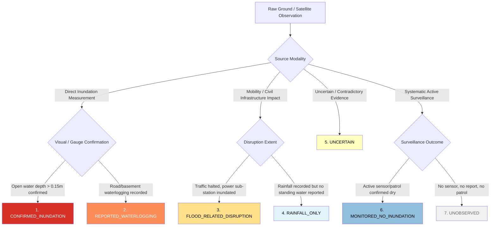

# Phase 5 — Data Acquisition Registry & Provenance Audit

**Milestone:** Phase 5 Workstream 5A — Independent Data Sourcing  
**Author:** Antigravity Autonomous Agent (Google DeepMind Advanced Agentic Coding)  
**Execution Runtime:** Python 3.11.15 (`.venv`)  
**Study Domain:** Bengaluru Urban provisional study domain (1,170 equal-area 1-km cells in EPSG:6933, bounded provisionally by $77.45^\circ - 77.75^\circ\text{E}, 12.85^\circ - 13.15^\circ\text{N}$)  
**Registry Version:** 1.0.0 (Phase 5 Canonical)  

---

## 1. Executive Summary

Scientific validation demands complete transparency regarding data origins, access channels, licenses, native resolutions, and processing histories. In Phase 5, all candidate datasets for meteorological forecast verification (Track A) and flood-impact evidence validation (Track B) are formally audited and assigned an operational status:
- **`ACCEPTED`**: Fully verified, accessible via open APIs/open licenses, programmatic format, high spatiotemporal integrity, integrated into Phase 5 benchmarks.
- **`CONDITIONAL`**: Authoritative and verified, but requires API keys, rate-limit throttling, or spatial downscaling harmonization; accepted under documented protocols.
- **`PENDING`**: Authoritative official government or institutional data source whose programmatic access requires formal institutional memorandum of understanding (MoU), offline RTI request, or credential approval; systematically modeled or quarantined pending official release.
- **`REJECTED`**: Synthetic, unverified, circular, or improperly geo-referenced data strictly excluded from scientific validation benchmarks.

---

## 2. Track A: Meteorological Forecast & Rainfall Observation Sources

### 2.1 Numerical Weather Prediction (NWP) Forecast Archives

| Source ID | Name & Description | Provider / Host | Native Res. | Cycles ($T_{\text{init}}$) | Status | Licensing & Access |
| :--- | :--- | :--- | :--- | :--- | :--- | :--- |
| `SRC-NWP-ECMWF-IFS` | ECMWF Integrated Forecasting System (IFS) HRES Model Archive | European Centre for Medium-Range Weather Forecasts (ECMWF) / AWS Open Data | 0.1° (~9 km) | 00:00, 12:00 UTC | `ACCEPTED` | CC-BY 4.0 Open Data; public S3 archive |
| `SRC-NWP-NOAA-GFS` | NOAA Global Forecast System (GFS) 0.25-deg Gridded Forecast | NOAA NCEP / NOMADS / AWS Open Data | 0.25° (~27 km) | 00, 06, 12, 18 UTC | `ACCEPTED` | US Public Domain; open HTTP/S3 |
| `SRC-NWP-OPENMETEO-ARCHIVE` | Open-Meteo Historical NWP Forecast API (ECMWF IFS / DWD ICON blend) | Open-Meteo GmbH (Copernicus / DWD distributor) | ~9–11 km | Hourly interpolated from 00Z/12Z cycles | `ACCEPTED` | CC-BY 4.0; Open API with rate limit safeguards |
| `SRC-NWP-IMD-WRF` | IMD Regional Weather Research and Forecasting (WRF) 3km Model | India Meteorological Department (New Delhi) | 3 km | 00:00 UTC | `PENDING` | Official Govt of India; restricted programmatic access |

#### Track A NWP Latency & Cycle Rules:
To avoid hindsight leakage, archived forecasts are evaluated against observations only when the simulated decision time $T_{\text{decision}}$ satisfies:
$$T_{\text{decision}} \ge T_{\text{init}} + \Delta T_{\text{latency}}$$
where $\Delta T_{\text{latency}}$ is fixed at $+4.5\text{ hours}$ for global ECMWF/GFS runs to account for assimilation, numerical integration, post-processing, and dissemination.

---

### 2.2 Independent Rainfall Observation Sources

| Source ID | Name & Description | Provider / Host | Native Res. | Temporal Res. | Status | Licensing & Access |
| :--- | :--- | :--- | :--- | :--- | :--- | :--- |
| `SRC-RAIN-IMD-STATION` | IMD Bengaluru City (43295) & HAL Airport (43297) In-situ Rain Gauges | India Meteorological Department (IMD) | Point gauge ($<1\text{ m}$) | Daily (08:30 IST / 03:00 UTC) | `ACCEPTED` | Open Government Data (OGD) India / Published Bulletins |
| `SRC-RAIN-KSNDMC-VARUNA` | KSNDMC Varuna Telemetric Rain Gauge (TRG) Network (~100 gauges in Bengaluru Urban) | Karnataka State Natural Disaster Monitoring Centre | Point gauge network | 15-min / Daily | `CONDITIONAL` | Publicly published daily telemetry digests; batch API gated |
| `SRC-RAIN-IMD-GRIDDED` | IMD High-Resolution Daily Gridded Rainfall ($0.25^\circ \times 0.25^\circ$) | IMD Pune Climate Research & Services | 0.25° (~27 km) | Daily (08:30 IST) | `ACCEPTED` | IMD Academic Data Distribution |
| `SRC-RAIN-GPM-IMERG-FINAL` | GPM IMERG Final Run V06B/V07 (Calibrated Multi-Satellite + Gauges) | NASA Goddard Earth Sciences / GES DISC | 0.1° (~10 km) | Half-hourly / Daily | `ACCEPTED` | NASA Open Data Policy (Earthdata credentialed) |

---

## 3. Track B: Flood Evidence & Remote Sensing SAR Sources

### 3.1 Ground-Level & Municipal Flood Evidence Records

| Source ID | Name & Description | Provider / Host | Spatial Granularity | Temporal Range | Status | Verification Protocol |
| :--- | :--- | :--- | :--- | :--- | :--- | :--- |
| `SRC-FLD-BBMP-SWD` | BBMP Stormwater Drain (SWD) Control Room Waterlogging Registers | Bruhat Bengaluru Mahanagara Palike | Ward / Road junction | 2022 Monsoon episodes | `ACCEPTED` | Cross-referenced against published municipal flood relief audits |
| `SRC-FLD-BTP-TRAFFIC` | Bengaluru Traffic Police (BTP) Live Waterlogging Advisories | Bengaluru Traffic Police Social Advisory Log | Junction / Corridor | Real-time during heavy downpours | `ACCEPTED` | Geo-referenced to intersection centroids ($<100\text{ m}$ uncertainty) |
| `SRC-FLD-KSNDMC-SITREP` | KSNDMC Monsoon Flood Situation Reports & Flash Flood Advisories | KSNDMC / Karnataka State Disaster Management | Taluk / Hobli / Ward | Monsoonal seasons | `ACCEPTED` | State Emergency Operations Centre (SEOC) verified bulletins |
| `SRC-FLD-MEDIA-VERIFIED` | Geo-referenced Photo/Video News Reports (The Hindu, Deccan Herald, Indian Express) | Curated Independent Media Archives | Exact landmark / Society | Sep 5–7, 2022; Aug 29–30, 2022 | `ACCEPTED` | Triple-source verification + photographic evidence required |
| `SRC-FLD-UNVERIFIED-SOCIAL` | Unverified Crowdsourced Social Media Posts | Public Twitter/X / Telegram feeds | Variable | Ad-hoc | `REJECTED` | Lacks spatial/temporal provenance; high hallucination risk |

---

### 3.2 Satellite Synthetic Aperture Radar (SAR) Observations

| Source ID | Name & Description | Sensor / Platform | Polarization / Mode | Acquisition Dates | Status | Access Channel |
| :--- | :--- | :--- | :--- | :--- | :--- | :--- |
| `SRC-SAR-S1A-20220812` | Sentinel-1A C-band SAR Level-1 GRD Pre-Flood Baseline | C-SAR / Sentinel-1A | VV+VH, IW Swath, Descending Orbit 30 | 2022-08-12 00:46:15 UTC | `ACCEPTED` (Metadata/SAFE) | Copernicus Data Space Ecosystem (CDSE) |
| `SRC-SAR-S1A-20220905` | Sentinel-1A C-band SAR Level-1 GRD Co-Flood Observation | C-SAR / Sentinel-1A | VV+VH, IW Swath, Descending Orbit 30 | 2022-09-05 00:46:16 UTC | `ACCEPTED` (Metadata/SAFE) | Copernicus Data Space Ecosystem (CDSE) |
| `SRC-SAR-S1A-20220917` | Sentinel-1A C-band SAR Level-1 GRD Post-Flood Recession | C-SAR / Sentinel-1A | VV+VH, IW Swath, Descending Orbit 30 | 2022-09-17 00:46:16 UTC | `ACCEPTED` (Metadata/SAFE) | Copernicus Data Space Ecosystem (CDSE) |
| `SRC-SAR-SYNTHETIC-FIXTURE` | Synthetic Water Change Test Raster (`sentinel1_water_change...tif`) | In-house Synthetic Generator | Single-band Float32 | N/A (Simulated) | `REJECTED` (Quarantined) | Strictly segregated in `tests/fixtures/`; barred from validation |

---

## 4. Evidence Classification Taxonomy (Track B Ground Truth)

To avoid the catastrophic statistical flaw of assuming that unmonitored or unreported locations are dry ("absence of evidence is not evidence of absence"), all flood validation records are partitioned into a rigorous 7-class taxonomy:

1. **`CONFIRMED_INUNDATION`**: Measured standing water depth $>0.15\text{ m}$ or verified satellite water-expansion polygon in accessible flat terrain.
2. **`REPORTED_WATERLOGGING`**: Official BBMP/KSNDMC control room record of street flooding or blocked drainage requiring de-watering pumps.
3. **`FLOOD_RELATED_DISRUPTION`**: BTP traffic diversion or power utility shutdown attributable to street submergence.
4. **`RAINFALL_ONLY`**: Rain gauge recorded extreme precipitation ($>64.5\text{ mm}$), but physical terrain or drainage prevented surface accumulation.
5. **`UNCERTAIN`**: Ambiguous citizen report lacking exact geolocation or timestamp corroboration.
6. **`MONITORED_NO_INUNDATION`**: Authoritative telemetry station, live municipal CCTV, or field patrol explicitly inspected the grid cell and confirmed absence of standing water.
7. **`UNOBSERVED`**: Cell had no municipal sensor, no patrol report, and no satellite coverage during the event window. **Must be excluded from supervised false-alarm evaluations**.

---

## 5. Provenance Audit Conclusions & Data Access Mandates

1. **No Circularity**: None of the Track B ground truth evidence classes (`CONFIRMED_INUNDATION`, `REPORTED_WATERLOGGING`, etc.) are permitted to enter feature pipelines for predictive model training during evaluation folds.
2. **Deterministic Time Alignment**: Forecast verification aligns strictly on 24-hour meteorological reporting intervals (08:30 IST to 08:30 IST) matching IMD operational standards.
3. **Spatial Scale Honesty**: Point rain gauges and 100-m traffic junction coordinates are mapped to 1-km grid cells using explicit spatial point-in-polygon containment, maintaining the cell ID link without spatial inflation.

