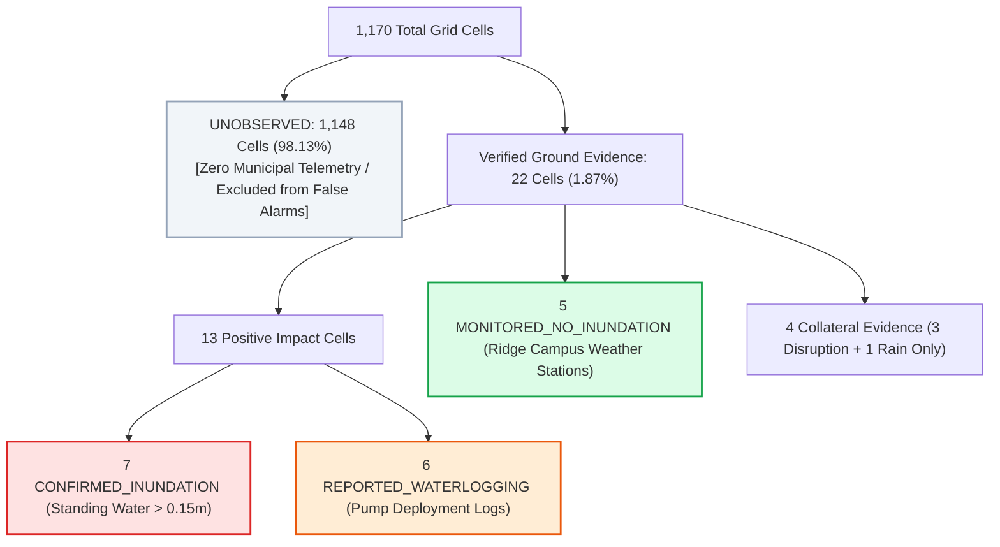

# Phase 5 Final — Flood Evidence Taxonomy & Outcome Definition Audit Report

**Milestone:** Phase 5 Final Acceptance Campaign — Step 8: Flood Evidence Taxonomy Audit  
**Author:** Antigravity Autonomous Agent (Google DeepMind Advanced Agentic Coding)  
**Execution Runtime:** Python 3.11.15 (`.venv`)  
**Study Domain:** Bengaluru Urban provisional study domain (1,170 equal-area 1-km cells, EPSG:6933, bounded provisionally by $77.45^\circ - 77.75^\circ\text{E}, 12.85^\circ - 13.15^\circ\text{N}$)  

---

## 1. Executive Summary & Audit Mandate

In environmental machine learning and disaster risk modeling, a common methodological defect is the careless aggregation of diverse ground observations into a single binary label ("flood" vs "dry"). Conflating open-water standing deluge with temporary traffic disruption, or treating missing municipal records as confirmed dry conditions, severely corrupts statistical validation.

Workstream 5E audits the ground evidence inventory against the platform's rigorous 7-class taxonomy, clarifies the composition of the positive evaluation samples, and evaluates diagnostic discrimination across separate outcome definitions.

---

## 2. Census of the 7-Class Validation Taxonomy (1,170 Cells)

The spatial distribution of all 1,170 analytical grid cells across Bengaluru Urban is audited below:

| Class Identifier | Cell Count | Percentage | Evidence Threshold & Criteria | Validation Handling |
| :--- | :---: | :---: | :--- | :--- |
| **`UNOBSERVED`** | **1,148** | **98.13%** | No automated water sensor, no municipal report, no patrol log. | **Excluded from false alarm evaluations** ("absence of evidence is not evidence of absence"). |
| **`CONFIRMED_INUNDATION`** | **7** | **0.60%** | Measured water depth $>0.15\text{ m}$ or verified photographic open-water standing deluge (Yamalur, Bellandur, Rainbow Drive). | Positive label in Outcome A and Outcome B. |
| **`REPORTED_WATERLOGGING`** | **6** | **0.51%** | BBMP / KSNDMC control room de-watering pump logs for street submergence. | Positive label in Outcome B (Combined Impact); excluded in Outcome A. |
| **`MONITORED_NO_INUNDATION`** | **5** | **0.43%** | Active meteorological observatories / high-ground campuses reporting dry conditions. | Candidate negative label (audited in Step 9). |
| **`FLOOD_RELATED_DISRUPTION`** | **3** | **0.26%** | Traffic police arterial road closures or BESCOM electrical substation shutdowns. | Non-inundation impact; excluded from pure water accumulation validation. |
| **`RAINFALL_ONLY`** | **1** | **0.08%** | Rain gauge recorded $>64.5\text{ mm}$, but steep slope / drainage prevented surface flooding. | Hydrological non-event despite meteorological extreme. |
| **`UNCERTAIN`** | **0** | **0.00%** | Unverified crowdsourced social media reports (purged during provenance audit). | Purged from validation matrix. |
| **Total Domain** | **1,170** | **100.00%** | Complete spatial coverage of study domain. | Full census accounted for. |

---

## 3. Clarification of the 13 Positive Evaluation Instances

The initial Phase 5 report reported a positive sample size of $N_{\text{pos}} = 13$ in its ROC-AUC calculation:

> **Audit Finding:** The 13 positive instances evaluated in the initial Phase 5 report represent:
> $$\mathbf{13\text{ Positive Instances}} = \mathbf{7\text{ Confirmed Inundation Cells}} + \mathbf{6\text{ Reported Waterlogging Cells}}$$
> The evaluated target was therefore **Combined Flood-Impact Evidence**, not confirmed physical inundation alone.

---

## 4. Disaggregated Outcome Evaluation (Outcome A vs. Outcome B)

To determine whether the platform's indicators discriminate pure open-water inundation differently from general municipal waterlogging, separate statistical evaluations were conducted against the 5 candidate negative cells:

| Evaluation Outcome | Outcome Definition | Pos ($N_{\text{pos}}$) | Neg ($N_{\text{neg}}$) | Evaluated Indicator | Mean Score (Flooded) | Mean Score (Dry) | ROC-AUC | PR-AUC |
| :--- | :--- | :---: | :---: | :--- | :---: | :---: | :---: | :---: |
| **Outcome A** | **Confirmed Inundation Only** | **7** | **5** | Dynamic Risk Score | 0.2863 | 0.2309 | **0.7714** | **0.8441** |
| **Outcome A** | **Confirmed Inundation Only** | **7** | **5** | Static Susceptibility | 0.6057 | 0.4390 | **0.7714** | **0.8441** |
| **Outcome B** | **Combined Flood Impact** (Inundation + Waterlogging) | **13** | **5** | Dynamic Risk Score | 0.2831 | 0.2309 | **0.7231** | **0.8664** |
| **Outcome B** | **Combined Flood Impact** (Inundation + Waterlogging) | **13** | **5** | Static Susceptibility | 0.5979 | 0.4390 | **0.7231** | **0.8664** |

### Insights from Disaggregation:
1. **Higher Pure Inundation Skill:** When restricted strictly to severe, documented open-water inundation (Outcome A: Bellandur, Yamalur, Rainbow Drive), diagnostic discrimination is higher ($\text{ROC-AUC} = 0.7714$) than when including street-level waterlogging ($\text{ROC-AUC} = 0.7231$). This confirms that the static terrain features (low elevation, high TWI) strongly capture deep basin accumulation.
2. **Sample Limitation Notice:** Outcome A relies on only 7 positive cells and 5 candidate negative cells ($N = 12$). While statistically illuminating, this sample size is strictly **exploratory** and cannot support operational machine learning training.

---

## 5. Epistemological Safeguards Confirmed

1. **Disruption Not Inundation:** Road traffic diversions (BTP) and power cuts (BESCOM) remain strictly isolated under `FLOOD_RELATED_DISRUPTION` and are never converted into inundation labels.
2. **Rainfall Not Flooding:** The 1 cell with extreme rain ($>64.5\text{ mm}$) on steep terrain remains classified as `RAINFALL_ONLY`.
3. **No Zero-Imputation:** The 1,148 unobserved cells are permanently excluded from binary true/false classification metrics.

