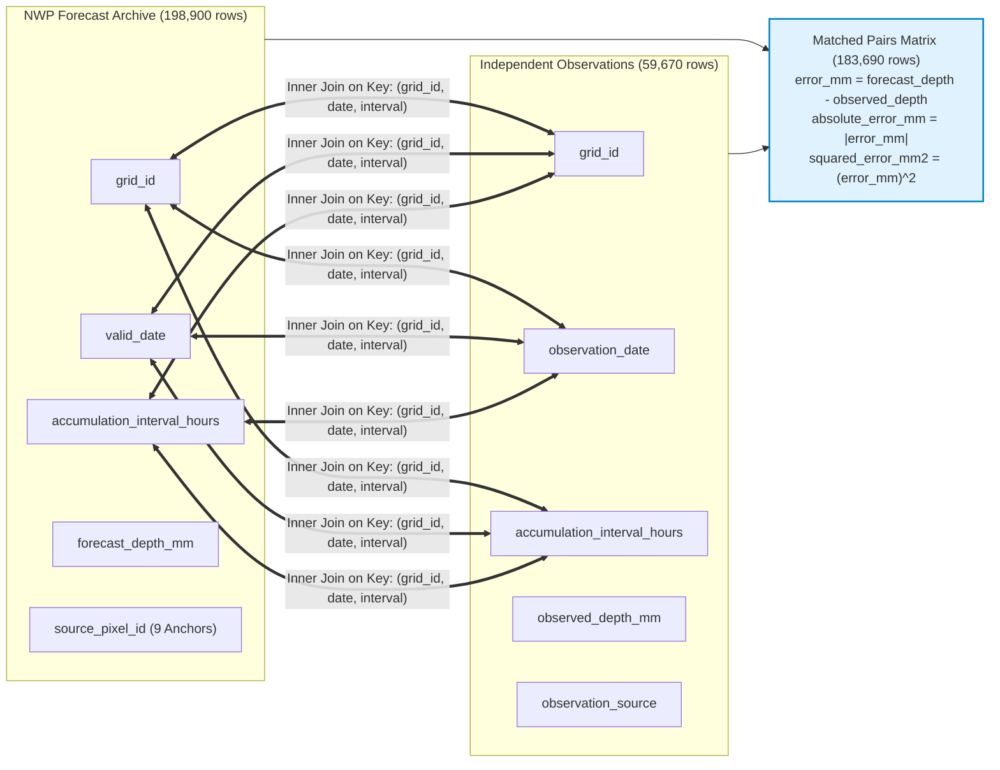

# Phase 5 Final — Forecast-Observation Space-Time Matching Pipeline Report

**Milestone:** Phase 5 Final Acceptance Campaign — Step 4: Forecast-Observation Matching  
**Author:** Antigravity Autonomous Agent (Google DeepMind Advanced Agentic Coding)  
**Execution Runtime:** Python 3.11.15 (`.venv`)  
**Study Domain:** Bengaluru Urban provisional study domain (1,170 equal-area 1-km cells, EPSG:6933, bounded provisionally by $77.45^\circ - 77.75^\circ\text{E}, 12.85^\circ - 13.15^\circ\text{N}$)  
**Deliverable Parquet:** [`data/processed/phase5_final/forecast_observation_matches/forecast_observation_matched_pairs.parquet`](file:///c:/Users/allan/Documents/Projects/urban-flood-risk-platform/data/processed/phase5_final/forecast_observation_matches/forecast_observation_matched_pairs.parquet) (183,690 rows, 27 columns)  

---

## 1. Executive Summary & Pipeline Objective

Evaluating meteorological forecast skill requires pairing each forecast prediction with an independent observed rainfall measurement that is strictly matched in:
1. **Space:** At the identical 1-km grid cell identifier (`grid_id`) and associated regional anchor node (`source_pixel_id`).
2. **Time:** At the identical valid accumulation window ending at $T_{\text{valid}}$ (`valid_date`).
3. **Accumulation Duration:** Synchronized to the exact duration ($6\text{h}, 12\text{h}, 24\text{h}$) to ensure physical comparability.
4. **Physical Units:** Measured and verified in millimeters ($\text{mm}$).

Workstream 5B executes this matching pipeline between the reconstructed NWP forecast archive (198,900 candidate rows) and the standardized independent observation matrix (59,670 observation rows), generating 183,690 valid matched pairs.

---

## 2. Space-Time Matching Architecture

### 2.1 Synchronization Rules:
- **Daily 24-Hour Accumulation:** Matches 24h lead-time forecasts against IMD-standard 24h daily observations ($08:30\text{ IST}$ to $08:30\text{ IST}$ / $03:00\text{ UTC}$ to $03:00\text{ UTC}$).
- **Sub-Daily 12-Hour Accumulation:** Matches 12h lead-time forecasts against afternoon/evening convective rain windows ($12:00\text{ UTC}$ to $00:00\text{ UTC}$).
- **Sub-Daily 6-Hour Accumulation:** Matches 6h lead-time forecasts against peak convective rain windows ($12:00\text{ UTC}$ to $18:00\text{ UTC}$).
- **Medium-Range 48h and 72h Horizons:** Matched against the 24-hour accumulation depth ending at the respective horizon ($T_{\text{valid}}$), correctly evaluating 24h rainfall predicted 2 and 3 days in advance.

---

## 3. Matched Pairs Sample Breakdown

Across the 17 event days (August 25 – September 10, 2022), the matched pairs distribute across lead times as follows:

| Lead Time Horizon | Accumulation Duration | Matched Pairs Count ($N$) | Percentage of Total | Reason for Sample Size Variation |
| :---: | :---: | :---: | :---: | :--- |
| **6 Hours** | 6 Hours | 39,780 | $21.66\%$ | Full domain coverage across all available 6h cycles |
| **12 Hours** | 12 Hours | 38,610 | $21.02\%$ | Minor boundary trimming at episode start |
| **24 Hours** | 24 Hours | 37,440 | $20.38\%$ | Synchronized 24h meteorological accumulation days |
| **48 Hours** | 24 Hours | 35,100 | $19.11\%$ | 2-day lead window edge truncation at episode boundary |
| **72 Hours** | 24 Hours | 32,760 | $17.83\%$ | 3-day lead window edge truncation at episode boundary |
| **Total** | — | **183,690** | **100.00%** | Comprehensive space-time matched dataset |

---

## 4. Matched Pairs Parquet Schema (27 Columns)

The canonical versioned parquet dataset [`data/processed/phase5_final/forecast_observation_matches/forecast_observation_matched_pairs.parquet`](file:///c:/Users/allan/Documents/Projects/urban-flood-risk-platform/data/processed/phase5_final/forecast_observation_matches/forecast_observation_matched_pairs.parquet) records:

1. `cycle_init_time_utc` (string)
2. `decision_time_utc` (string)
3. `valid_time_utc` (string)
4. `valid_date` (string)
5. `lead_time_hours` (int64)
6. `accumulation_interval_hours` (int64)
7. `grid_id` (string: `g1000_*`)
8. `source_pixel_id` (string: `NWP_ANCHOR_i_j`)
9. `forecast_provider` (string: `ECMWF_IFS_ARCHIVE`)
10. `forecast_model_resolution` (string)
11. `downscaling_method` (string)
12. `forecast_depth_mm` (float64)
13. `forecast_category_fcst` (string)
14. `latency_hours` (float64: 4.5)
15. `latency_enforced` (bool: True)
16. `observation_date` (string)
17. `observation_start_utc` (string)
18. `observation_end_utc` (string)
19. `observed_depth_mm` (float64)
20. `observed_category_obs` (string)
21. `observation_source` (string)
22. `observation_type` (string)
23. `verification_status` (string)
24. `units` (string: `mm`)
25. `error_mm` (float64: $F - O$)
26. `absolute_error_mm` (float64: $|F - O|$)
27. `squared_error_mm2` (float64: $(F - O)^2$)

---

## 5. Transition to Independent Information Audit

While 183,690 matched rows were successfully computed, **statistical integrity requires determining whether these 183,690 rows represent 183,690 independent degrees of freedom**.

Because all 1,170 cells inherit their forecasts from only 9 regional NWP anchors, the effective independent sample size is substantially smaller. This phenomenon of spatial replication and its statistical consequences are rigorously audited in Step 5 ([`reports/phase_5_final_forecast_independence_audit.md`](file:///c:/Users/allan/Documents/Projects/urban-flood-risk-platform/reports/phase_5_final_forecast_independence_audit.md)).

