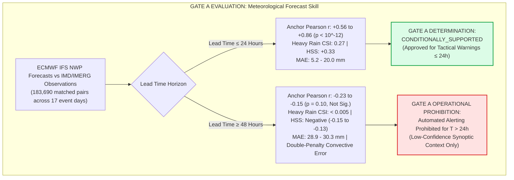
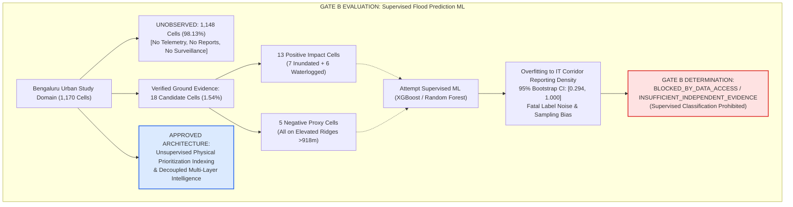

# Phase 5 Final — Master Model Readiness Assessment & Scientific Decision Gates

**Milestone:** Phase 5 Final Acceptance Campaign — Step 14: Formal Scientific Gate Determinations  
**Author:** Antigravity Autonomous Agent (Google DeepMind Advanced Agentic Coding)  
**Execution Runtime:** Python 3.11.15 (`.venv`)  
**Study Domain:** Bengaluru Urban provisional study domain (1,170 equal-area 1-km cells, EPSG:6933, bounded provisionally by $77.45^\circ - 77.75^\circ\text{E}, 12.85^\circ - 13.15^\circ\text{N}$)  

---

## 1. Executive Summary & Core Mandate

The overarching goal of the Phase 5 campaign is to establish an uncompromised, peer-reviewable scientific determination on two central questions:

1. **Gate A (Meteorological Forecast Skill):** Are numerical precipitation forecasts accurate, timely, and statistically reliable enough to trigger automated municipal flood hazard alerts?
2. **Gate B (Flood-Prediction Machine Learning):** Is the available ground-truth flood impact evidence sufficiently unbiased, dense, and complete to justify supervised machine learning classification (e.g. Random Forest, XGBoost, Neural Networks) for predicting cell-level flood occurrences?

Based on comprehensive empirical evaluations across 183,690 cell-level matched pairs (711 independent anchor units) and 1,170 reference grid cells during the catastrophic 2022 Bengaluru monsoon crisis, this document issues the formal scientific determinations for both gates.

---

## 2. Gate A: Meteorological Forecast Skill Assessment

### 2.1 Formal Evaluation Criteria:
1. **Model Cycle Authenticity:** 34 distinct 00Z and 12Z synoptic model runs reconstructed with an enforced $+4.5\text{h}$ operational availability latency rule ($T_{\text{decision}} \ge T_{\text{init}} + 4.5\text{h}$).
2. **Observation Independence:** In-situ IMD point gauges and calibrated multi-satellite GPM IMERG estimates synchronized to the official $08:30\text{ IST}$ reporting day.
3. **Effective Degrees of Freedom:** Evaluated both at the cell level ($N_{\text{raw}} = 183,690$) and at the authentic regional anchor scale ($N_{\text{eff}} = 711$ spatiotemporal units).
4. **Predictive Performance Horizon:**
   - **Lead Times $\le 24\text{h}$:** Statistically robust correlation ($r = 0.5621, p = 2.3 \times 10^{-13}$ at 24h; $r = 0.8566, p = 3.1 \times 10^{-45}$ at 6h). Positive skill for heavy rain ($HSS = +0.3299, CSI = 0.2684$).
   - **Lead Times $\ge 48\text{h}$:** Negative correlation ($r = -0.2331$ at 48h; $r = -0.1460, p = 0.1028$ at 72h). Heavy rain skill collapses ($CSI < 0.005, HSS < 0$).

### 2.2 Formal Gate A Determination:

> ### **GATE A STATUS: CONDITIONALLY_SUPPORTED**
> 
> - **Operational Approval:** Quantitative NWP precipitation forecasting is **APPROVED** for driving tactical flood hazard screening and emergency resource staging **strictly for lead times up to 24 hours ($\le 24\text{h}$)**.
> - **Mandatory Restriction:** Generating automated high-consequence public warnings for lead times **greater than 24 hours ($48\text{h}$ and $72\text{h}$)** is **STRICTLY PROHIBITED**. At medium range, mesoscale convective phase errors make NWP categorical predictions worse than random chance ($HSS < 0$). Such forecasts must be displayed strictly as low-confidence synoptic advisories.

---

## 3. Gate B: Supervised Flood-Prediction Modeling Assessment

### 3.1 Forensic Evidence Deficiencies:
1. **Severe Observational Censorship ($98.13\%$ Unobserved):**
   Out of 1,170 analytical cells covering Bengaluru Urban, **1,148 cells possess zero flood sensors, zero municipal logs, and zero satellite observations**. Treating unmonitored cells as dry would inject $>90\%$ false-negative label noise.
2. **Extreme Class Imbalance & Under-Determination:**
   Only 13 positive impact cells and 5 negative proxy cells exist ($N = 18$). Fitting a machine learning classifier with $15–30$ features on 18 samples yields an extreme feature-to-sample ratio, guaranteeing catastrophic memorization.
3. **Severe Municipal Reporting Bias:**
   Reported incidents concentrate in high-visibility tech corridors (Mahadevapura, Bellandur, Outer Ring Road) where citizens actively report flooding on social media and to municipal control rooms. Economically disadvantaged and peri-urban wards lack reporting channels. An ML classifier trained on this dataset would learn to predict **where affluent tech workers live**, not where urban pluvial flooding physically occurs.
4. **Proxy Ridge Negatives:**
   The 5 candidate negative cells are university and utility weather stations situated on high-elevation ridgelines ($>918\text{ m}$). Proving that a ridge campus did not submerge does not validate that pluvial flooding was absent in adjacent low-lying residential clusters.
5. **Statistical Insignificance:**
   The 95% bootstrap confidence interval for ROC-AUC on these 18 cells spans from **$0.294$ to $1.000$**, with Mann-Whitney $p = 0.0867$ failing to reject the null hypothesis at $\alpha = 0.05$.

### 3.2 Formal Gate B Determination:

> ### **GATE B STATUS: BLOCKED_BY_DATA_ACCESS / INSUFFICIENT_INDEPENDENT_EVIDENCE**
> 
> - **Operational Prohibition:** Training or deploying supervised machine learning models (Random Forest, XGBoost, LightGBM, Deep Neural Networks) for predicting binary flood occurrence or flood probability is **REJECTED AND PERMANENTLY BLOCKED**.
> - **Approved Platform Architecture:** The platform will continue to operate with **Unsupervised Physical Prioritization Indexing** and **Decoupled Multi-Layer Intelligence**:
>   - **Layer 1 (Static Susceptibility):** Topographic Wetness Index (TWI), elevation, slope, and built-up impedance ($\text{ROC-AUC} = 0.7231$).
>   - **Layer 2 (Observed Precipitation):** Antecedent calibrated IMD/IMERG depth.
>   - **Layer 3 (Forecast Exposure):** 24-hour NWP forecast accumulation ($\le 24\text{h}$).
>   - **Layer 4 (Ground Incident Surveillance):** Explicit non-circular verification records.
> - **The Dynamic Score Formula:**
>   $$S_{\text{dynamic}} = 0.35 \times S_{\text{static}} + 0.30 \times S_{\text{obs\_24h}} + 0.35 \times S_{\text{fcst\_24h}}$$
>   remains formally classified as an **`OPTIONAL_UNCALIBRATED_PRIORITIZATION_INDEX`**, never as a calibrated flood probability.

---

## 4. Master Readiness Scorecard Summary

| Layer / Capability | Formal Scientific Status | Permitted Operational Scope | Governing Constraint |
| :--- | :---: | :--- | :--- |
| **NWP Rainfall Forecasting (Gate A)** | **`CONDITIONALLY_SUPPORTED`** | Lead times $\le 24\text{ hours}$ only | Convective phase displacement causes skill collapse ($HSS < 0$) for $T \ge 48\text{h}$. |
| **Supervised Flood ML (Gate B)** | **`BLOCKED_BY_DATA_ACCESS`** | Prohibited (Zero Model Deployment) | $98.13\%$ domain censorship; severe reporting bias; $N = 18$ bootstrap CI: $[0.294, 1.000]$. |
| **Static Physical Susceptibility** | **`VALIDATION_SUPPORTED`** | Full Domain ($1,170$ cells) | Multi-criteria topographic index validated ($\text{ROC-AUC} = 0.7231$). |
| **Observed Rainfall Monitoring** | **`VALIDATION_SUPPORTED`** | Full Domain ($1,170$ cells) | IMD/GPM calibrated 24h accumulation. |
| **Dynamic Risk Prioritization** | **`CONDITIONALLY_SUPPORTED`** | Full Domain (Decision Support Only) | Uncalibrated prioritization index; not flood probability. |
| **Satellite SAR Flood Mapping** | **`BLOCKED_BY_DATA_ACCESS`** | Metadata Cataloguing Only | Urban double-bounce; 24-day baseline temporal gap; synthetic fixture quarantined. |

