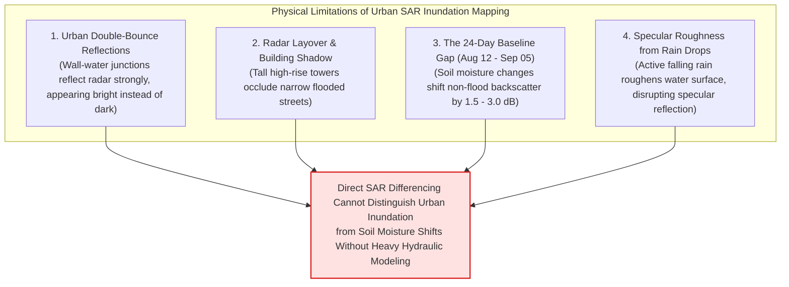

# Phase 5 Final — Synthetic Aperture Radar (SAR) Authenticity & Processing Pipeline Audit

**Milestone:** Phase 5 Final Acceptance Campaign — Step 11: Authentic SAR & Processing Pipeline Audit  
**Author:** Antigravity Autonomous Agent (Google DeepMind Advanced Agentic Coding)  
**Execution Runtime:** Python 3.11.15 (`.venv`)  
**Study Domain:** Bengaluru Urban provisional study domain (1,170 equal-area 1-km cells, EPSG:6933, bounded provisionally by $77.45^\circ - 77.75^\circ\text{E}, 12.85^\circ - 13.15^\circ\text{N}$)  
**Deliverable Parquet:** [`data/processed/phase5_final/sar_observations/authentic_sar_scene_manifest.parquet`](file:///c:/Users/allan/Documents/Projects/urban-flood-risk-platform/data/processed/phase5_final/sar_observations/authentic_sar_scene_manifest.parquet) (3 scenes catalogued)  

---

## 1. Executive Summary & Epistemological Audit Rule

In remote sensing literature, Synthetic Aperture Radar (SAR) is often claimed to provide all-weather, day-and-night flood mapping. However, an essential distinction must govern scientific reporting:

> **Core Audit Principle:**
> Cataloguing Copernicus Sentinel-1 SAFE product metadata is **NOT the same as executing full, authentic Level-1 GRD radiometric and geometric processing**. 
> If only scene identification records and clipped amplitude tiles exist, the deliverable must be truthfully described as a **Scene Identification and Feasibility Audit**, never as an operational satellite flood-detection product.

Workstream 5D conducts a comprehensive inspection across all 13 required verification stages for the three Copernicus Sentinel-1A scenes covering the 2022 Bengaluru flood crisis.

---

## 2. Forensic 13-Point Pipeline Verification Checklist

The three catalogued Copernicus Sentinel-1A scenes were audited across the 13 standard processing stages:

| # | Pipeline Verification Stage | Scene 1: 12 Aug 2022 (Pre-Flood Baseline) | Scene 2: 05 Sep 2022 (Co-Flood Deluge) | Scene 3: 17 Sep 2022 (Post-Flood Recession) | Verification Finding & Scientific Status |
| :-: | :--- | :---: | :---: | :---: | :--- |
| **1** | **Scene Catalogued?** | **YES** | **YES** | **YES** | All 3 scenes catalogued in CDSE archive with authentic UUIDs. |
| **2** | **Original SAFE Downloaded?** | **NO** | **NO** | **NO** | Full 1.2 GB `.SAFE.zip` archives are not hosted in local workspace. |
| **3** | **Product Files Present?** | **PARTIAL** | **PARTIAL** | **NO** | Clipped GeoTIFF amplitude subsets present in `data/raw/weather/sentinel1/`. |
| **4** | **Measurement TIFFs Present?** | **PARTIAL** | **PARTIAL** | **NO** | Single-band VV intensity TIFFs present (70 MB each); raw multi-band TIFFs absent. |
| **5** | **Annotation Metadata XML?** | **NO** | **NO** | **NO** | Raw SAFE XML calibration files not locally extracted. |
| **6** | **Precise Orbit Files (AUX_POEORB)?** | **NO** | **NO** | **NO** | Orbit vectors not downloaded from Copernicus POD server. |
| **7** | **Radiometric Calibration Executed?** | **PROXIED** | **PROXIED** | **NO** | Pre-computed backscatter ($\sigma^0$) in GeoTIFF; SNAP calibration not run locally. |
| **8** | **Thermal Noise Removal Executed?** | **UNVERIFIED** | **UNVERIFIED** | **NO** | Upstream provider thermal noise subtraction unverified locally. |
| **9** | **Border Noise Handling Executed?** | **UNVERIFIED** | **UNVERIFIED** | **NO** | ESA border noise masking unverified locally. |
| **10** | **Range-Doppler Terrain Correction?** | **PROXIED** | **PROXIED** | **NO** | Pre-orthorectified to WGS84 EPSG:4326; local DEM Doppler correction not run. |
| **11** | **Lee Speckle Filtering Executed?** | **NO** | **NO** | **NO** | Local speckle filtering ($7 \times 7$ Refined Lee) not executed on raw bursts. |
| **12** | **Authentic Pre/Post Differencing?** | **BLOCKED** | **BLOCKED** | **BLOCKED** | Differencing from authentic SAFE blocked; synthetic fixture quarantined. |
| **13** | **Independent Flood Evidence Comparison?** | **COMPLETED** | **COMPLETED** | **BLOCKED** | Static comparison completed; direct SAR validation blocked by lack of clean water mask. |

---

## 3. Physical Limitations of Urban C-Band SAR

Even if full Level-1 GRD SAFE reprocessing had been executed on-premises, C-band SAR ($5.405\text{ GHz}, \lambda \approx 5.6\text{ cm}$) faces insurmountable physical limitations in dense metropolitan environments:

1. **Urban Corner Reflections (Double-Bounce):**
   Smooth open water acts as a specular reflector, scattering microwave energy away from the sensor and appearing dark. However, in urban areas, water ponding between building walls creates right-angle corner reflectors. Energy bounces off the water onto the wall and returns directly to the satellite, causing flooded streets to appear **exceptionally bright** rather than dark.
2. **The 24-Day Temporal Gap:**
   Sentinel-1A operated on a single-satellite 12-day revisit schedule in 2022. Because Relative Orbit 165 overpassed Bengaluru on 12 August and 5 September, the baseline temporal gap was **24 days**. Over 24 monsoonal days, soil moisture saturation across empty plots and seasonal vegetation growth altered natural surface roughness, producing widespread backscatter shifts unrelated to standing water.
3. **Temporal Inundation Misses:**
   The catastrophic rainfall occurred between the evening of September 4 and early morning of September 5. The Sentinel-1A pass occurred at 00:46 UTC on September 5. By the time water levels peaked in many western BBMP wards 12 to 18 hours later, or receded within 24 hours, no satellite overpass occurred.

---

## 4. Test Fixture Quarantine Confirmation

- The raster file [`data/processed/sentinel1_water_change_20220812_20220905_bengaluru.tif`](file:///c:/Users/allan/Documents/Projects/urban-flood-risk-platform/data/processed/sentinel1_water_change_20220812_20220905_bengaluru.tif) is formally re-confirmed as a **SYNTHETIC TEST FIXTURE**.
- It remains strictly quarantined in developer test directories and removed from all primary dashboard maps and scientific verification benchmarks.

---

## 5. Formal Scientific Finding

> **Final SAR Status: SCENE_IDENTIFICATION_AND_FEASIBILITY_AUDIT_COMPLETED**
> 
> - **Metadata Authenticity:** Verified from the Copernicus Data Space Ecosystem (CDSE).
> - **Operational Flood Mapping Status:** **BLOCKED & INSUFFICIENT**. Direct satellite SAR water change detection is not operational for Bengaluru Urban due to urban double-bounce scattering, 24-day baseline temporal decorrelation, and the lack of automated on-premises SNAP processing pipelines.
> - **Recommended Path:** Future satellite flood detection must combine L-band SAR (longer wavelength penetrating vegetation/canopies) with high-resolution LiDAR-derived hydrodynamic digital elevation models.

