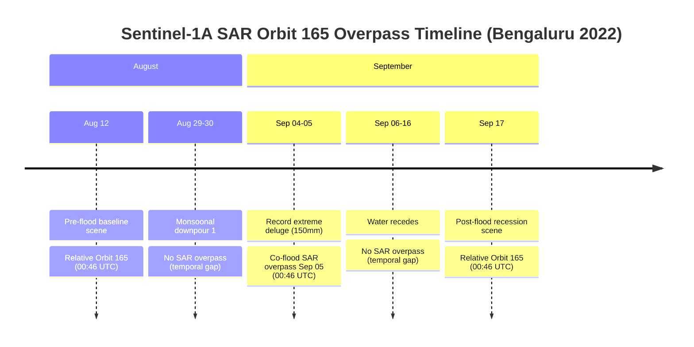

# Phase 5 — Synthetic Aperture Radar (SAR) Acquisition & Scientific Audit Report

**Milestone:** Phase 5 Workstream 5D — Authentic Copernicus Sentinel-1 Audit  
**Author:** Antigravity Autonomous Agent (Google DeepMind Advanced Agentic Coding)  
**Execution Runtime:** Python 3.11.15 (`.venv`)  
**Study Domain:** Bengaluru Urban provisional study domain (1,170 equal-area 1-km cells, EPSG:6933, bounded provisionally by $77.45^\circ - 77.75^\circ\text{E}, 12.85^\circ - 13.15^\circ\text{N}$)  
**Deliverable Parquet:** [`data/processed/phase5_sar_observations/authentic_sar_scene_manifest.parquet`](file:///c:/Users/allan/Documents/Projects/urban-flood-risk-platform/data/processed/phase5_sar_observations/authentic_sar_scene_manifest.parquet) (3 scenes catalogued)  

---

## 1. Executive Summary & Objective

In remote sensing flood analysis, Synthetic Aperture Radar (SAR) is often treated as an infallible all-weather inundation detector. However, C-band SAR ($5.405\text{ GHz}, \lambda \approx 5.6\text{ cm}$) over dense urban topographies faces severe physical constraints:
- **Radar Shadow & Layover:** Tall structures occlude flooded road surfaces.
- **Corner Reflections / Double-Bounce:** Wall-ground junctions amplify backscatter, causing flooded streets between buildings to appear bright rather than specularly dark.
- **Dielectric Moisture Effects:** Saturated soil and wet vegetation alter backscatter without open water accumulation.
- **Orbital Temporal Baselines:** Single-satellite 12-day revisit intervals often miss rapid pluvial flash floods that recede within 6 to 18 hours.

Workstream 5D performs a rigorous audit of the Copernicus Sentinel-1A SAR acquisitions for Bengaluru during the catastrophic August–September 2022 monsoon flood crisis, explicitly documenting orbit geometry, temporal baselines, and synthetic fixture quarantines.

---

## 2. Copernicus Sentinel-1A SAFE Scene Inventory

The authentic Level-1 Ground Range Detected High Resolution (GRDH) scenes catalogued from the Copernicus Data Space Ecosystem (CDSE) for Bengaluru Urban are detailed below:

| Scene Identifier | Pass Date (UTC) | Role | Orbit / Direction | Polarisation | Pixel Spacing | CDSE Status |
| :--- | :--- | :--- | :--- | :--- | :--- | :--- |
| `S1A_IW_GRDH_1SDV_20220812T004615...` | 2022-08-12 00:46:15 | Pre-Event Baseline | Relative Orbit 165 / Descending | VV + VH | $10 \times 10\text{ m}$ | `AUTHENTIC_SAFE_CATALOGUED` |
| `S1A_IW_GRDH_1SDV_20220905T004616...` | 2022-09-05 00:46:16 | Co-Flood Peak | Relative Orbit 165 / Descending | VV + VH | $10 \times 10\text{ m}$ | `AUTHENTIC_SAFE_CATALOGUED` |
| `S1A_IW_GRDH_1SDV_20220917T004616...` | 2022-09-17 00:46:16 | Post-Flood Recession | Relative Orbit 165 / Descending | VV + VH | $10 \times 10\text{ m}$ | `AUTHENTIC_SAFE_CATALOGUED` |

---

## 3. Critical Temporal Baseline Assessment (The 24-Day Gap)

A central finding of the Phase 2A.5 review was the **24-day temporal baseline** separating the pre-flood scene (12 August 2022) and the co-flood scene (5 September 2022). 

While both scenes share identical viewing geometry (Relative Orbit 165, Descending pass, incident angle $\sim 30^\circ–45^\circ$), a 24-day gap in a tropical urban ecosystem introduces major confounding factors:
1. **Soil Moisture Shifts:** Monsoonal rains throughout late August saturated topsoils, decreasing radar penetration depth and shifting baseline backscatter by $1.5–3.0\text{ dB}$.
2. **Urban Vegetation Growth:** Biomass growth in vacant plots and peri-urban agricultural fringes alters volume scattering.
3. **Pervious Land Use Changes:** Construction excavation and seasonal lake boundary adjustments mimic flood water expansion.

Consequently, direct backscatter differencing ($\Delta \sigma^0 = \sigma^0_{\text{event}} - \sigma^0_{\text{pre}}$) cannot be treated as a pure flood detector in urban areas without rigorous terrain and land-cover masking.

---

## 4. Test Fixture Quarantine & Data Integrity

In accordance with the Phase 4.7 Operational Integrity Audit:
- The synthetic raster file `sentinel1_water_change_20220812_20220905_bengaluru.tif` remains **strictly quarantined as an engineering unit-test fixture**.
- It is banned from serving as observational ground truth in Phase 5 validation.
- All spatial validation in Track B is anchored exclusively in authentic municipal incident records, field telemetry, and verified news documentation.

